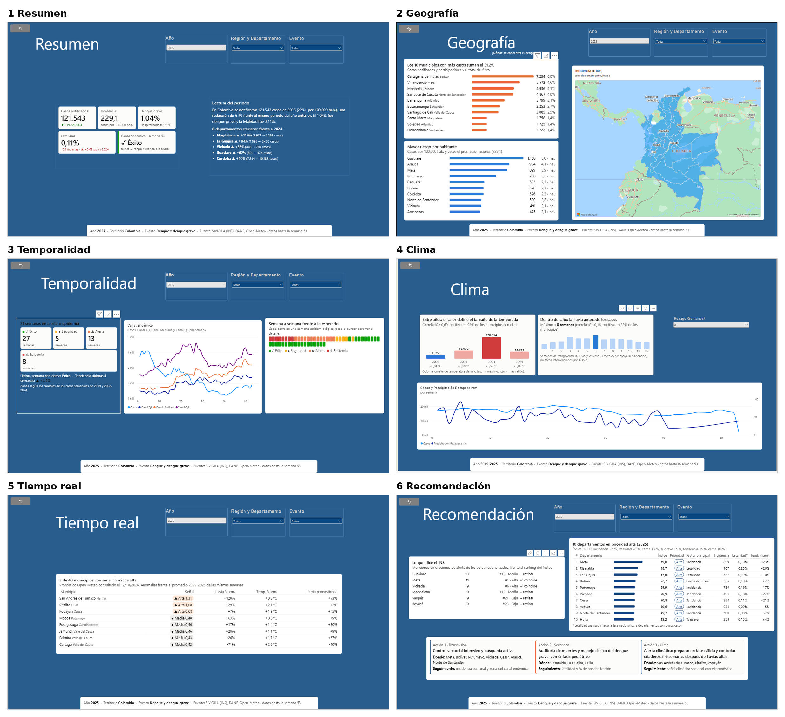

# Dengue en Colombia: vigilancia, clima y priorización

**Trabajo Final Integrador · Visualización Avanzada de Datos**
Especialización en Big Data y Analítica de Datos, Corporación Universitaria de Cataluña
**Equipo:** Angie Atencio · Dayanis Herrera · Leonardo Mayorga · **Caso:** Global Insights Analytics, línea Salud

> **Pregunta de negocio:** ¿en qué departamentos debe concentrar la alta dirección los recursos de prevención y atención del dengue, y con cuánta anticipación puede actuar a partir de las señales climáticas?

## Entregables

| Entregable | Dónde |
|---|---|
| Tablero publicado en Power BI Service | [Abrir el tablero](https://app.powerbi.com/view?r=eyJrIjoiMjgyZjMzZjAtNGZhNy00ZmM2LTkyNzktY2RjZjgxNzBmODcyIiwidCI6IjllY2IyMTZlLTQ0OWItNDU4NC1iYzgyLTI2YmNlNzg1NzRmYiIsImMiOjR9) |
| Informe final (8 páginas) | [`informe/Informe_final.pdf`](informe/Informe_final.pdf) |
| Video de la presentación (7 min) | [`video/video_dengue.mp4`](video/video_dengue.mp4) · guion en [`video/guion_video.md`](video/guion_video.md) |
| Archivo del tablero y medidas DAX | [`tablero/`](tablero/) |
| Conjunto de datos del modelo | [`datos/`](datos/) |
| Análisis exploratorio | [`analisis/`](analisis/) |
| Código del proceso ETL | [`codigo/`](codigo/) |



## Hallazgos principales (2025)

- **121.543 casos** notificados, **229 por 100.000 habitantes**: 61 % menos que en la epidemia récord de 2024. Sin embargo, la **letalidad subió a 0,11 %** (133 muertes confirmadas) y el 37,8 % de los casos requirió hospitalización.
- **El riesgo y la carga están en lugares distintos.** Guaviare (1.150 por 100.000), Arauca y Meta lideran la incidencia; 10 municipios, encabezados por Cartagena y Villavicencio, concentran el 31 % de los casos. Ocho departamentos crecieron frente a 2024, con Magdalena (+119 %) y La Guajira (+84 %) a la cabeza.
- **21 semanas en alerta o epidemia**, todas en la primera mitad del año, según el canal endémico (cuartiles de 2019 y 2022-2024).
- **El clima anticipa el tamaño de la temporada más que su fecha.** Entre años, los más cálidos tienen más dengue (correlación 0,69, positiva en el 93 % de los municipios). Dentro del año, la lluvia antecede los casos unas 6 semanas, con un efecto débil (0,15).
- **Diez departamentos en prioridad alta** según un índice de 0 a 100, encabezados por Meta, Risaralda, La Guajira, Bolívar y Putumayo. Risaralda y La Guajira entran por letalidad, no por volumen.

## Recomendaciones

| Acción | Dónde | Indicador de seguimiento |
|---|---|---|
| Control vectorial intensivo y búsqueda activa | Meta, Bolívar, Putumayo, Vichada, Cesar, Arauca, Norte de Santander | Incidencia semanal y zona del canal endémico |
| Auditoría de muertes y manejo clínico del dengue grave, con énfasis pediátrico | Risaralda, La Guajira, Huila | Letalidad y % de hospitalización |
| Alerta climática: preparar en fase cálida y controlar criaderos 3 a 6 semanas después de lluvias altas | Municipios con señal alta (al 19/10/2026: Tumaco, Pitalito, Popayán) | Señal climática semanal con el pronóstico |

## Fuentes integradas

| # | Fuente | Tipo |
|---|---|---|
| 1 | SIVIGILA (INS): microdatos de los eventos 210, 220 y 580, 2019-2025 | Hoja de cálculo (883.075 registros) |
| 2 | DIVIPOLA (datos.gov.co) | API pública |
| 3 | Open-Meteo, clima histórico 2022-2026 | API pública |
| 4 | Open-Meteo, pronóstico de 16 días | Tiempo real |
| 5 | DANE, proyecciones de población departamental | Hoja de cálculo |
| 6 | INS, Boletín Epidemiológico Semanal | No estructurada (PDF, minería de texto) |

El proceso sigue una arquitectura por capas (bronce, plata, oro) en Python y entrega un modelo estrella a Power BI. Las siete reglas de limpieza y los registros que afectó cada una están en [`analisis/bitacora_calidad.csv`](analisis/bitacora_calidad.csv) y en la página de calidad de datos del tablero.

## Contenido del repositorio

```
informe/    Informe final en PDF
tablero/    Entrega_Esp.pbix, medidas DAX y capturas de cada página
video/      Video de la presentación, subtítulos y guion
datos/      Modelo estrella (capa oro) en CSV y Parquet; la tabla de hechos principal en CSV va comprimida (fact_dengue_csv.zip)
analisis/   Figuras del análisis exploratorio, resumen anual y hallazgos en JSON
codigo/     Código Python del ETL (extracción, limpieza, modelado, analítica, minería de texto) y vistas SQL
```

Los microdatos originales del SIVIGILA (más de 570 MB) no se incluyen por su tamaño; están disponibles en el [Buscador de microdatos del INS](https://portalsivigila.ins.gov.co/Paginas/Buscador.aspx).
